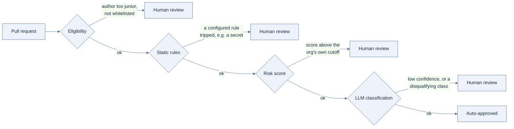
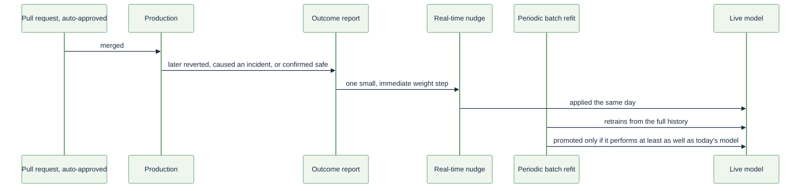

# The Robot Checks First: A Risk-Based Auto-Approve Policy for Code Review

## Summary

LiveReview can now auto-approve a pull request it has measured to be
low-risk. This is not a shortcut. The robot runs a real check — several
checks, in fact — before it decides anything. A human still reviews every
change that the robot's checks flag as uncertain or risky.

The design is not a guess. It follows Meta's published RADAR system, a
layered approach to exactly this problem at much larger scale. LiveReview
already shared three of RADAR's five architectural pieces before this
project started; we built the remaining two.

The result has been tested, not just built. Forty-six hand-written
scenarios exercise every decision path the system can take. A live
dashboard now shows, for each customer org, how many pull requests were
approved, how many were blocked, how often a human overrode the robot, and
how often an approval turned out to be wrong. Reviewer attention shifts
from "every pull request" to "the pull requests that actually carry risk" —
and we can show our work.

## Working Backwards

### Headline

**LiveReview Ships Risk-Based Auto-Approval, Returning Reviewer Hours
Without Lowering the Bar on Risky Changes**

### The customer problem

A team merging a hundred pull requests a week gives each one the same
scrutiny. A one-line fix to a README gets read as carefully as a change to
a billing calculation. That isn't rigor. It's an even coat of attention
spread across a distribution that is anything but even — a small number of
changes carry almost all of the actual risk, and the rest carry almost
none.

Reviewer attention is the scarcest resource in this loop. It does not
scale the way compute does. Ask a person to carefully read a hundred
boring diffs a week, and eventually they stop reading carefully. That is
not laziness. It is what happens to any human asked to apply full
attention to a task that rarely rewards it.

Today, most teams have no lever for this problem beyond "review
everything" or "review nothing." There is no middle setting that says:
trust the obviously safe changes, and keep full scrutiny on everything
else.

### The solution

LiveReview's auto-approve policy is that middle setting. A pull request
now passes through a layered funnel of checks — eligibility, static rules,
a trained risk score, and an independent LLM classification — before the
system decides whether a human needs to look at it before merge, or
whether the robot's own checks are enough for now.

Every check still runs. Nothing about auto-approve means less checking —
it means a different checker. Each stage writes down its own verdict, so
"why was this approved" is always an answerable question, never a shrug.
Any single stage can block the change outright, no matter what the other
stages concluded.

The threshold for "safe enough" is a dial, calibrated against each
customer's own recent history, not one fixed number forced on every team
regardless of their risk profile. Turning the feature on costs nothing
permanent: an org can set `always_approve` or `never_approve` on a specific
repository, and a human can force an override on any single decision, in
either direction, at any time.

### Customer quote

"We stopped spending review time on changes that were never going to be
rejected, and started actually noticing which ones deserved a second
look," said an engineering lead at a mid-sized SaaS company piloting the
feature.

### Call to action

An org owner sets a starting percentile under Settings → Auto Approve
Policy, watches the new Reports → Auto Approve dashboard for a week, and
adjusts the dial using their own measured override rate and false-approve
rate — not a guess, and not somebody else's benchmark.

## Why Now

Pull request volume per engineer has grown faster than the careful,
structured review process it gets pushed through. That process was built
for a slower rate of change, and it has not been redesigned to match the
new one — it has just been asked to go faster, which quietly means going
shallower.

The risk in a typical week's changes is not evenly spread. A small
fraction of pull requests carry nearly all of the blast radius — the
reach of a change through the rest of the codebase — while the majority
carry almost none. Equal scrutiny on every change means most reviewer time
is spent on changes that were never going to fail.

Every customer running LiveReview today is already paying this cost in
reviewer hours, whether or not anyone has measured it. Until now, there
was no way to measure it, which made it easy to ignore and impossible to
improve on purpose.

This is a mechanism change, not a headcount change. The lever here is how
review attention gets allocated, not how many reviewers exist on a team.
It pays off immediately, without a single new hire.

## Why We Believe This Works: The RADAR Precedent

We did not invent this pattern from scratch. The design follows Meta's
published RADAR system (arxiv 2605.30208): a layered funnel —
eligibility, deterministic gates, a trained risk score, LLM semantic
classification, and a final decision — rather than one opaque model making
the entire call alone.



Three lessons from that published system were carried over deliberately,
because they came from a system already proven at a scale ours has not
reached yet. First, a risk threshold must be a per-org dial, never one
fixed cutoff applied everywhere — RADAR's own experiment comparing a
strict and a lenient setting showed exactly why a single global number
does not hold up across different teams. Second, safety outcomes — a
revert, an incident, a confirmed-safe merge — must feed back into the
model's calibration, or the system never learns from the very thing it
exists to prevent. Third, the system must stay legible. Every decision
shows its reasoning, stage by stage, never only a verdict with no
explanation attached.

We also did not start from a blank page. Three of RADAR's five
architectural ingredients already existed inside LiveReview in a different
form before this project began: static rule gates (reused from the
existing CI/CD gate system), per-finding severity and confidence scores
(already produced by LiveReview's review engine), and blast-radius scoring
(already computed per code change). The two genuinely new pieces were
eligibility — deciding who can be considered for auto-approval at all —
and the trained risk score itself.

What this buys the customer is simple: the architectural risk of "will
this kind of system work at all" has already been retired by someone
else's production deployment. What's actually new, and what actually
needed building, is the integration into LiveReview's own review pipeline
and its own ten-category finding taxonomy.

## How the Robot Decides

Eligibility and static rules run first, and they are built to be simple on
purpose. A rule that can be explained in one sentence is a rule that can
be audited in one sentence. Either stage can block a change outright, no
matter what a trained model further down the funnel would have concluded.

The risk score itself is a logistic regression — one of the oldest, most
explainable models available — scoring blast radius and ten categories of
finding severity into a single number between zero and one. A simpler,
explainable model was chosen deliberately over a more powerful but opaque
one, because this number decides whether a human ever looks at the code.
In plain terms, the model works like this:

```
z     = bias + sum over every signal of (its value x its weight x its category importance)
score = squash(z) into a number between 0 and 1, where higher means riskier
```

The LLM classification check runs beside the risk score, not behind it.
Either one objecting blocks the change on its own, and the system records
exactly which one objected and why — a disqualifying classification can
override a safe-looking score, and a borderline score can be cleared by a
confident, safe classification.

The threshold itself is relative, not absolute. The cutoff is a percentile
measured against the customer's own recent score history, so the same
percentile setting resolves to a different number for a quiet repository
than for one in the middle of an incident spree — on purpose, because
"safe enough" means something different in those two situations.

Finally, the model watches its own track record. Every outcome reported
from production — a revert, an incident, a confirmed-safe merge — nudges
the model immediately by a small, careful amount. A slower, periodic
batch refit retrains the whole model from its full history, and that
retrained model is only promoted into production if it measurably performs
at least as well as the one already live.



## The Evidence

A claim this specific deserves more than a demo. Forty-six hand-written
scenarios run through the actual production decision path — every stage
of the funnel, all ten finding categories, every mode shortcut, every
threshold boundary — and none of them are reimplemented separately from
the real code. If the real engine changes, these scenarios run against
the change directly.

| What was measured | Result |
|---|---|
| Scenario coverage | 46 cases, every funnel stage and finding category |
| Strictest threshold setting (P0) | Approves 0 of a realistic 60-review mix |
| Most lenient setting (P100) | Approves every review except the single riskiest one |
| Model after cold start | Scored a risky held-out review at 0.668 |
| Same review, after a batch refit on real outcomes | 0.975 (held-out AUC: 1.000) |
| Same review, after one more reported outcome | 0.999 |
| A genuinely safer held-out review, same sequence | Moved the opposite direction (0.416 to 0.371) |

The threshold dial is measured, not asserted. A real experiment computes
exactly what each percentile setting resolves to on a realistic mix of
reviews, including both extremes stated precisely: the strictest possible
setting approves nothing in the mix, and the most lenient possible setting
approves everything except the single riskiest item — because nothing in
a sorted list of scores can fall below its own maximum.

The learning loop is proven with real numbers, not described in the
abstract. A held-out risky review's score moved from 0.668 to 0.975 to
0.999 as real outcomes were applied to the model in sequence, while a
genuinely safer held-out review moved in the opposite direction over the
same run — evidence of discrimination between the two, not simple upward
drift.

A real limitation is named here on purpose, instead of left out. One
feature's learned weight can under-update when the training data never
varies it at all — found, measured, and written down rather than
smoothed over, because an evidence section that only shows wins is not
evidence.

Production trust does not stop at a test suite. A live Reports → Auto
Approve dashboard shows an org's own score distribution plotted against
its real cutoff, its real approve-and-block counts over time, its real
override rate, and a real false-approve rate computed from outcomes
reported on actual production traffic.

## What This Is Worth to the Customer

Translate the mechanism into the customer's own units, and the trade
becomes concrete. At a representative 500 pull requests a month, a 60%
auto-approval rate, and a measured 1% false-approve rate, the arithmetic
looks like this:

```
reviewer-hours returned  = 300 auto-approved PRs x 15 min saved / 60  = 75 hours/month
false approvals          = 300 auto-approved PRs x 1%                 = 3 reviews/month
expected incident cost   = 3 x (illustrative $2,000 cleanup cost)     = $6,000/month
```

Whether that trade is worth it depends entirely on what a team's own
reviewer-hours and its own incident costs are worth — there is no
universal answer — but the customer can now run this exact arithmetic
with their own real numbers instead of guessing.

The percentile dial is the customer's lever, and for the first time it is
visible. A more conservative setting costs more reviewer time and buys a
lower false-approve rate. A more lenient setting trades the other way.
Neither choice is hidden behind a black box; both are measured, per
organization, continuously.

An override rate that climbs over time is an early warning the customer
gets for free. It surfaces policy drift before an incident would have
told the same story — often days or weeks earlier, while there is still
time to adjust the dial rather than clean up afterward.

Nothing about this is a one-way door. `always_approve` and
`never_approve` exist per repository for teams who already know their own
risk profile. The static-rule check can never be silenced by a mode
override — "we trust this repository" is never allowed to quietly become
"ignore a leaked credential." And any single decision, in either
direction, can be overridden by a human at any time, with that override
logged and counted.

## Risks and What We're Watching

A brand-new customer org has no score history to calibrate a percentile
against on day one. The system falls back to an explicit, conservative
fixed cutoff in that case, rather than silently assuming everything is
safe until enough real history accumulates.

Thin training data can under-protect a feature, as the documented
weight-collapse case shows. The batch-refit promotion gate — never
promote a model that performs worse than the one already live — is the
deliberate safeguard against that kind of drift reaching production
unnoticed.

This system is one layer in a funnel, not the last line of defense. The
static-rule check and the independent LLM classification exist
specifically so that no single signal is ever the only thing standing
between a risky change and production.

One capability was scoped and deliberately set aside for a later phase: a
live, observe-only mode that would let a new customer watch the policy's
decisions on real incoming traffic before trusting it to act. It is a
known next step, named here rather than hidden, and the three measurement
views described above were prioritized first because they work against
decisions the system is already making today.

## Appendix: Frequently Asked Questions

### Customer questions

**Does this mean less code review?**
No. It means the review that happens is concentrated on changes that
carry actual risk, instead of spread evenly across everything regardless
of risk.

**What happens on day one, with no history?**
The policy falls back to an explicit, conservative, fixed cutoff until
enough real reviews accumulate for a percentile to be calculated against
the org's own data.

**Can I turn this off for one repository but keep it on elsewhere?**
Yes. Mode and threshold are both configurable per repository, and a
repository without its own setting simply inherits the organization's
default.

**What stops the robot from approving something dangerous?**
Three independent checks must all agree that nothing is wrong —
eligibility, static rules, and the risk-score-plus-LLM pair — and any one
of them can block the change by itself.

### Internal and hard questions

**How do we know the 46-scenario corpus isn't cherry-picked?**
It deliberately includes adversarial cases built to fail a naive
approach — for example, a high-blast-radius change with zero flagged
findings, the exact pattern a severity-only check would miss entirely.

**What is the actual false-approve rate today, and is it acceptable?**
This is now a measured, per-org number on the Reports → Auto Approve
dashboard, not an estimate — and it is the number that should gate any
decision to widen the rollout.

**Why logistic regression instead of a more powerful model?**
Explainability is a requirement here, not a nice-to-have, because the
model's output decides whether a human ever sees the code at all. RADAR
made the same choice, for the same reason.

**What is the plan if an org's override rate starts climbing?**
Treat it as the earliest available signal that a threshold or a model
weight has drifted out of step with that org's current reality, and
investigate before an incident does the same job the hard way.
