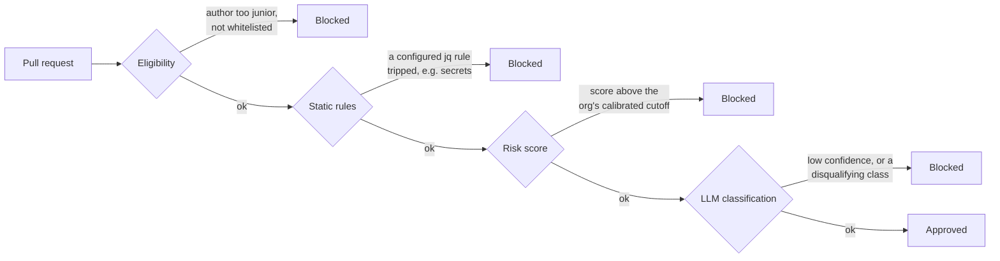
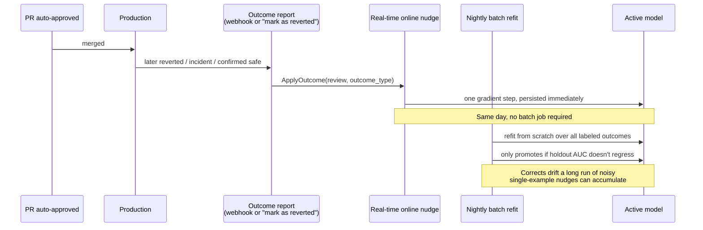

# How the Risk-Based Auto-Approve Engine Works (and How We Know)

This document explains the risk-based auto-approve policy engine
(`internal/policyengine`, `internal/riskscore`) at three depths — read as far
as you need. Every number quoted below comes directly from a passing,
rerunnable test in this repository, not a hypothetical example; the exact
commands to reproduce each one are in **"How do we know this works"** at the
end. The full architectural spec is `docs/risk-policy-engine.md`; this
document is the explainer, not a second spec.

## 1. For leadership

Every pull request that goes through LiveReview's auto-approve flow passes
through a funnel of independent checks, not one opaque model:



Any single stage can block the PR; a human review is always the fallback. A
`mode=always_approve` or `never_approve` setting (for repos a team has
already decided are low- or high-stakes) can skip the eligibility/risk/LLM
stages entirely, but the static rules stage — the one that can catch things
like a hardcoded secret — **always still runs**, even under
`always_approve`. "We trust this repo" is never allowed to silently become
"ignore a secrets leak."

The risk score itself is a small, auditable statistical model (not a large
language model making a holistic judgment call) that starts from hand-set,
common-sense defaults and gradually adapts as real production outcomes
(reverts, incidents, confirmed-safe merges) are reported against it. Two
safety nets exist regardless of what the model says: a human can always
**force-approve** a blocked PR (with a mandatory, audited reason), and a
configurable **landing delay** gives humans a window to object after an
auto-approval before it's considered final.

## 2. For engineering managers

### The funnel's knobs, and where to find them

| Stage | What it checks | Where it's configured |
|---|---|---|
| Eligibility | PR author's `review_level` vs. the policy's `min_author_level`, or an explicit whitelist | Settings → Auto Approve Policy → Eligibility |
| Static rules | Existing CI/CD jq rulesets, reused as-is (`ci_rulesets`) | Settings → Auto Approve Policy → Static Rules |
| Risk score | A trained score vs. a percentile cutoff calibrated from the org's own recent review history | Settings → Auto Approve Policy → Risk Model (weights) + General (threshold) |
| LLM classification | The review LLM's diff-level class (`refactor-only`, `logic-change`, `security-sensitive`, …) and its confidence | Settings → Auto Approve Policy → General |

Every evaluation writes a `review_policy_log` row per stage, so the Review
Detail page's Auto Approve tab can show exactly which stage passed, failed,
or was skipped, and why — the same reasons a worked example below quotes.

### The feedback loop



The two paths are complementary, not redundant: the real-time nudge is what
makes a single newly reported incident move the score *that day*; the
nightly (or on-demand, via "Retrain now") batch refit is what keeps a long
sequence of small, possibly-noisy nudges from drifting away from a globally
well-fit model, and it has a safety gate — a refit that doesn't do at least
as well on held-out data as the current model doesn't get promoted.

**What to watch, ongoing**: the Risk Model sub-tab's model-confidence
indicator ("Low — common-sense defaults, N outcomes recorded" vs
"Calibrated, N outcomes recorded") tells you how much of the current score
is learned vs. default. The metrics dashboard (§11 of the architecture doc)
tracks revert/incident rate on auto-approved PRs and the force-approval
audit log — the sharpest signal available for "is this policy too strict or
too lax," since every force-approval is a human explicitly overriding the
engine.

## 3. For engineers

### The score, exactly

```
Score = sigmoid(bias + Σ_i effective_weight_i · feature_i)
effective_weight_i = learned_weight_i × category_multiplier(category(i))
```

- `sigmoid`, `Score`, `scoreRaw`: `internal/riskscore/model.go`
- The feature vector (append-only, index-stable across model versions):
  `internal/riskscore/features.go`'s `FeatureSpecs` — blast-radius
  aggregates (`br_sum`, `br_max`, `br_weighted_avg`, `br_high_count`),
  severity counts (`critical_count`, `warning_count`), `security_count`,
  diff shape (`files_changed`, `lines_added`, both `log1p`-compressed),
  `llm_class_risk`, and one count feature per remaining taxonomy category
  (`reliability_count`, `correctness_count`, `performance_count`, …).
- `category_multiplier`: `DefaultCategoryMultiplier` in `model.go` —
  `blast_radius` ×2.0 (weighted highest of all; see the commit that moved it
  there), `security` ×1.5, `correctness`/`reliability` ×1.25,
  `performance` ×1.1, everything else ×1.0 — overridable per org via
  `risk_factor_overrides`, applied instantly with no retrain
  (`categoryOverride` in `model.go`).

### Every feature's valid range

So a reader can judge what a normal value looks like, rather than guess:

| Feature | Measures | Valid range |
|---|---|---|
| `br_sum` | Sum of every hunk's blast-radius score | 0 and up — each hunk is 0-100 by convention (`internal/blastradius.Tier`), but the sum across many hunks can exceed 100 |
| `br_max` | The single highest-scoring hunk | 0-100 |
| `br_weighted_avg` | Hunk scores averaged, weighted by lines touched | 0-100 |
| `br_high_count` | Count of hunks scoring ≥66 ("high" tier) | 0 and up, an integer |
| `critical_count`, `warning_count` | Count of findings at that severity, any category | 0-500 — `storagereviews.ListFindings`'s hard `limit` parameter (`internal/canonicaldoc/canonicaldoc.go`) |
| `files_changed`, `lines_added` | Diff shape | 0 and up, uncapped, but `log1p`-compressed before reaching the formula so a 10× bigger diff doesn't add 10× more to the score |
| `llm_class_risk` | The diff's AI classification, mapped to a risk ordinal | Exactly one of `0`, `0.5`, `1` — never continuous (`classRisk` in `features.go`) |

### All 10 finding-taxonomy categories have their own signal, weight, and dial

Not collapsed into "the other N categories" — every category the Settings
UI shows a weight slider for has a dedicated feature here, with its own
starting weight (`Prior()`) and starting category multiplier
(`DefaultCategoryMultiplier`). A batch refit or an online nudge updates
every one of these weights together, in the same pass — none of them is
special-cased out of learning:

| Category | Feature | Starting weight | Starting dial |
|---|---|---|---|
| Security | `security_count` | 0.55 | ×1.50 |
| Reliability | `reliability_count` | 0.30 | ×1.25 |
| Correctness | `correctness_count` | 0.30 | ×1.25 |
| Performance | `performance_count` | 0.20 | ×1.10 |
| Scalability | `scalability_count` | 0.12 | ×1.00 |
| Compliance & Governance | `compliance_governance_count` | 0.12 | ×1.00 |
| Maintainability | `maintainability_count` | 0.10 | ×1.00 |
| Architecture | `architecture_count` | 0.10 | ×1.00 |
| Developer Experience | `developer_experience_count` | 0.10 | ×1.00 |
| Cost | `cost_count` | 0.10 | ×1.00 |

A `×1.00` starting dial doesn't mean "ignored" — it means "not weighted up
or down relative to the others yet." Every one of these 10 is independently
adjustable from the Settings UI's Risk Model sub-tab (the same page that
used to hide several of these under a collapsed "Other" section — see the
commit that fixed that), and the change applies to the very next score,
with no retrain required.

### The prior anchor

Every org starts from one shared, hand-set seed model (`Prior()` in
`model.go`), not a zero- or randomly-initialized one — this is the
"common-sense first" default, not a placeholder. Both learning paths blend
back toward it:

```
AnchorStrength(n) = λ / (λ + n),   λ = 1.0
```

At `n=0` (no labeled outcomes yet), `AnchorStrength = 1.0` — the model is
entirely the prior. By a few hundred outcomes, the pull is negligible and
the weights are effectively data-driven. `TestAnchorStrengthMonotonicallyDecreasing`
(`internal/riskscore/riskscore_test.go`) locks this curve's shape in as a
regression guard. The real-time `OnlineStep` uses the same anchor, scaled
instead by `λ/(1+sampleCount)` per step — `TestOnlineStepRegularizationWeakensAsSampleCountGrows`
confirms this pull measurably weakens as an org accumulates more outcomes,
so a single noisy report early on can't swing the model, while the same
report matters less once there's a real track record.

### Worked examples (from the scenario corpus, `internal/policyengine/testdata/scenarios.json`)

Run `go test ./internal/policyengine/... -run TestScenarios -v` to reproduce
these exactly:

| Scenario | Score | Decision | Why |
|---|---|---|---|
| `readme-only-edit` | 0.420 | Approved | No findings, no blast radius, safe LLM class. 0.420 is compared against **0.5, the cold-start fallback cutoff a brand-new org with zero scored reviews uses** — not a permanent threshold every org compares against. See "Is the threshold a fixed number?" below; an org with real history compares against its own percentile cutoff instead, almost never 0.5. |
| `huge-refactor-critical-security-finding` | 1.000 | Blocked (risk) | High blast radius **and** a critical security finding compound: `blast_radius` weight ×2.0, `security` weight ×1.5 — either alone would likely have blocked it; together the score saturates. |
| `high-blast-radius-silent-landmine-no-findings` | 0.999 | Blocked (risk) | Zero findings at all (the LLM reviewer found nothing to flag line-by-line) — blast radius alone catches what per-finding severity counts miss. This is the exact scenario the risk stage exists for. |
| `threshold-p80-lenient-approves-borderline-score` / `threshold-p10-strict-blocks-same-score` | 0.582 (both) | Approved / Blocked | The *identical* review, scored identically, under two different `risk_threshold_percentile` settings against the same seeded org calibration curve. Proves the percentile dial is a real lever on the decision, not just cosmetic. |
| `llm-disqualifying-class-high-confidence-blocks` | 0.476 | Blocked (llm) | The risk score alone (0.476) would approve; the LLM gate blocks anyway, because `security-sensitive` is a disqualifying class regardless of confidence — RADAR's "any risk signal disqualifies" rule, implemented literally. |

### The learning loop, with real before/after numbers

`internal/riskscore/learning_cycle_test.go`'s `TestLearningCycleProvesFeedbackLoopWorks`
runs a full synthetic cycle and logs this exact progression (`go test
./internal/riskscore/... -run TestLearningCycle -v`):

1. **Cold start** (seed model, 0 outcomes): a moderate-blast-radius review
   scores **0.668**.
2. **After a batch refit** on 40 synthetic historical outcomes (odd-indexed
   ones deliberately labeled "reverted" at moderate-to-high blast radius,
   even-indexed ones "confirmed safe" at low blast radius): the same review
   now scores **0.975** (holdout AUC **1.000** on this cleanly separable
   synthetic set — the mechanism discriminates perfectly on data it's
   supposed to). A held-out low-blast-radius review's score *decreased*
   over the same refit (0.416 → 0.371), in the opposite direction, as
   expected.
3. **After one more real-time "revert" report** (no batch job, one
   gradient step via `ApplyOutcome`): the same review's score moves again,
   to **0.999**.

Total movement, entirely driven by reported outcomes and zero manual weight
edits: **+0.331**. This is the direct answer to "does the ML feedback
actually do anything": yes, measurably, in the expected direction, and the
test asserts the direction (not just that nothing crashed) so a future
regression in `OnlineStep`, `Refit`, or the anchor math would fail this test.

**Why, exactly** — the test now also logs the full before/after weight
vector around the batch refit (`logWeightDeltas` in
`learning_cycle_test.go`), not just the two probe scores:

| Weight | Before | After | Change |
|---|---|---|---|
| `br_sum` | 0.0200 | 0.0536 | +0.0336 |
| `br_max` | 0.0100 | 0.0533 | +0.0433 |
| `br_weighted_avg` | 0.0100 | 0.0533 | +0.0433 |
| `critical_count` | 0.9000 | 0.0273 | −0.8727 |

The three blast-radius weights moved up because blast radius was the one
and only pattern the 40 synthetic outcomes varied. `critical_count`'s
weight collapsed toward near-zero *not* because the model decided critical
findings don't matter — it's because none of the 40 synthetic examples had
one, so the fresh batch fit has zero evidence to estimate that weight from,
and the prior anchor at this sample count (`AnchorStrength(40) ≈ 0.024`,
i.e. a 97.6%-fitted/2.4%-prior blend) is too weak to fully protect an
untouched feature. In a real org, outcomes would come from many different
kinds of problems, not one — this specific, large drop is a property of
this test's deliberately narrow, single-pattern synthetic data, not a
general claim about how a real refit behaves. It's a useful thing to know
when reading a real weight-change log and seeing an untouched category's
weight move: check whether the training batch actually had any examples
that varied that feature at all.

### Is the threshold a fixed number?

No — and this is worth stating precisely, because an earlier version of this
documentation didn't and it caused real confusion. There are two separate
things with the same-sounding name:

- The **setting** (`risk_threshold_percentile`, e.g. `20` for "P20") is a
  plain config value an org admin picks. It stays fixed until someone
  changes it. **Today's default is P20.**
- The **cutoff** (an actual score, e.g. `0.518`) is what that setting
  resolves to, recalculated from the org's own recent score distribution
  every time (`PercentileCutoff` in `internal/riskscore/calibration.go`).
  It moves on its own as the org's review history changes, with zero admin
  action.

`internal/riskscore/threshold_experiment_test.go`'s
`TestThresholdExperimentSamePercentileDifferentCutoff` proves this
directly: the same `P20` setting, run against two different synthetic score
histories, produces two different cutoffs — `0.220` for a "quiet" org whose
recent scores sit mostly in the 0.20-0.38 range, `0.540` for a "busy" org
whose recent scores sit mostly in 0.50-0.86. Same setting, different number.

### What does P10/P20/P50/P80 actually do to the approval rate?

`TestThresholdExperimentApprovalRatesByTier` (same file) scores a synthetic,
realistic mix of 60 reviews (mostly small and clean, a smaller medium-risk
group, a few clearly risky ones) and computes the resulting cutoff and
approval rate at each tier:

| Setting | Cutoff | Approval rate on this mix |
|---|---|---|
| P0 (the strictest possible setting) | 0.423 | 0% |
| P10 (strict) | 0.494 | 8% |
| P20 (today's default) | 0.518 | 18% |
| P50 (relaxed) | 0.572 | 48% |
| P80 (very relaxed) | 0.944 | 78% |
| P100 (the most relaxed possible setting) | 1.000 | 98% |

The concrete, named examples matter more than the percentages: at `P80`, a
review with **one critical security finding** (score `0.859`) gets
*approved* in this mix, because the cutoff itself has risen to `0.944` — a
high enough percentile setting, against a sufficiently risky recent history,
can let a real critical finding through. This is the literal, demonstrated
reason the shipped default is `P20` rather than something looser; it is not
a hypothetical concern, it is reproducible with `go test
./internal/riskscore/... -run TestThresholdExperiment -v`.

**The two edges, stated precisely, and proved by the same test:**
`PercentileCutoff` clamps `p<=0` to `1`, so `P0` and `P1` behave
identically — their cutoff is the mix's own single lowest score, and
nothing in a set can score strictly below that set's own lowest score, so
**P0 approves nothing, not even the safest review in the mix**. `P100`'s
cutoff is the mix's own single highest score, and that one review can never
score strictly below its own value, so **P100 approves every review except
the single riskiest one** — "P100 allows everything" is almost right, but
not quite. Both edges are asserted in
`TestThresholdExperimentApprovalRatesByTier`, not just described.

**Every one of the 46 scenario-corpus cases, at every one of these six
settings** — not just the 7 named examples above — is a sortable table in
`docs/risk-policy-verification-report.html`'s Thresholds tab, built from the
same `scenarioDump.tiers` data `TestScenarios` now logs per case
(`internal/policyengine/scenario_test.go`), measured against this exact
same reference mix (`internal/riskscore/referencemix`, imported by both
test packages so the numbers can never drift apart).

### A real gotcha this verification pass found

`storagereviews.TaxonomyReportStore.ListFindings` (which `canonicaldoc.Build`
uses to populate the risk model's finding-count features) silently excludes
any finding without both a `file_path` and a parseable `line` number — by
design, as a filter for "only rows that look like persisted line findings."
In practice every real review finding carries both, so this doesn't affect
production scoring — but it means a finding missing location data
contributes **zero** to every severity/category feature, not a fallback
value. Worth knowing if a future prompt or parser change ever produces a
finding without a file/line.

## How do we know this works

Three kinds of evidence, in increasing order of how close to production
they are:

1. **The scenario corpus** — `internal/policyengine/testdata/scenarios.json`,
   46 hand-authored "common sense" cases (docs-only edits, huge risky
   refactors, every eligibility/LLM/static-gate/mode-override/threshold/cap
   boundary) run against the *real* `engine.RunWithPolicy` dry-run path (the
   same one the Settings UI's simulate panel uses) — not a parallel
   reimplementation.
   ```
   go test ./internal/policyengine/... -run TestScenarios -v
   ```
2. **Formal-ish property and unit tests** — `internal/riskscore/riskscore_test.go`
   and `refit_test.go`: category-override precedence, a randomized
   monotonicity sweep over the seed prior (increasing any single risk
   signal must never lower the score), the anchor-strength decay curve, the
   batch refit's promotion gate, and the real-time online nudge, all against
   a real Postgres.
   ```
   go test ./internal/riskscore/... -v
   go test ./internal/api/... -run TestSimulateScoresRealReviewsWithNoSideEffects -v
   ```
3. **The learning-cycle test** — the single most direct "proof" artifact;
   see the numbers quoted above.
   ```
   go test ./internal/riskscore/... -run TestLearningCycle -v
   ```
4. **The threshold experiment** — `internal/riskscore/threshold_experiment_test.go`,
   answers "what does the percentile setting do" and "is it static" with
   computed numbers rather than a toy example; see the two sections above.
   ```
   go test ./internal/riskscore/... -run TestThresholdExperiment -v
   ```

An interactive version of everything above — a sortable/filterable table of
all 46 scenarios with the full per-feature arithmetic, the threshold
experiment's tables, and a live score calculator — is published as
`docs/risk-policy-verification-report.html`. Open it directly in a browser;
it has no server dependency.

All three write real rows to whatever Postgres `DATABASE_URL` points at
(local dev or the live instance) and clean up everything they write via
`t.Cleanup`, verified by running the full suite twice in a row and
confirming row counts return to zero — so it's safe to rerun any of them,
repeatedly, against a live environment.

**What this does *not* prove**: these are all synthetic/deterministic tests
of the *mechanism* — that the math is correct, the gates fire in the right
order, and the learning updates move in the right direction on data
engineered to have a known answer. They do not, and cannot, prove the model
is *accurate* on real, messy production data — that evidence only comes
from the metrics dashboard (§11 of `docs/risk-policy-engine.md`) once real
`review_outcomes` accumulate, which will read near-empty until an org
actually starts reporting reverts/incidents. Mechanism-correctness and
real-world-accuracy are different claims; this document is evidence for the
first, not the second.
