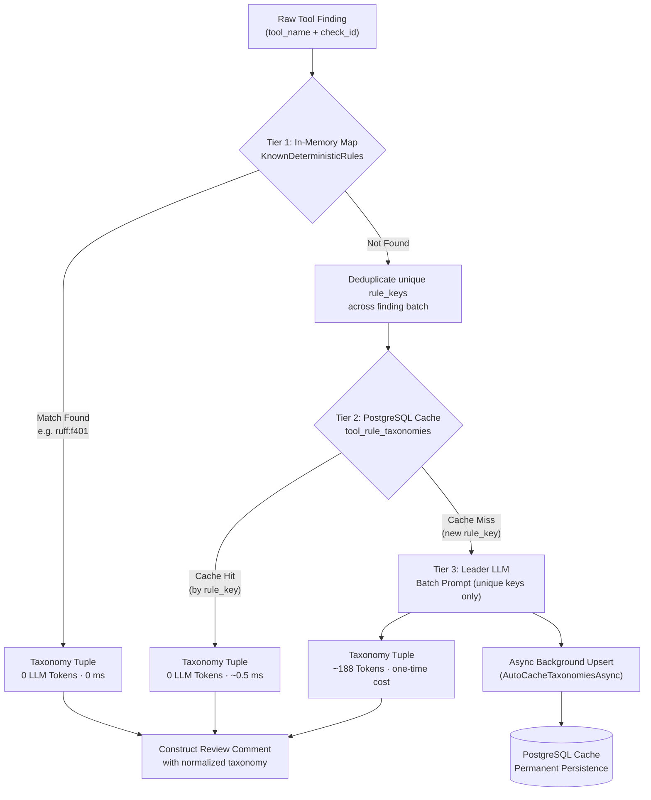

# Third-Party Tools Integration – Beta

LiveReview runs external static analysis tools as parallel AWS Lambda worker jobs alongside or independently of AI code reviews.
The system stores findings as `tool_result` events in the `review_events` database table.
The system displays findings in the review web interface and in the `lrc` command line interface.

This feature is available in cloud mode only for paid organizations.
Non-cloud (self-hosted) environments completely omit third-party tools: no tool UI, no settings tab, and no tool API endpoints exist.
Tool definitions are managed and registered manually through the `lr-tools` repository; no tools can be added or registered via the LiveReview API. If no tools are registered in the cloud catalog, the UI displays *"No tools registered — Tools are not available at the moment."*
An organization owner or super admin must enable tools in organization settings.
The implementation covers backend orchestration, multi-tier taxonomy classification, credit accounting, and user interfaces.

## Current System Status

All core components of the tools integration architecture are complete, verified, and active.

The system includes the following operational components:

- The **Tool Analysis Card** (`ui/src/components/reviews/ToolAnalysisCard.tsx`) renders on the `ReviewDetail` page.
- Database migration `20261102221500_create_tools_integration.sql` establishes credit counters, rule taxonomies, and audit ledgers.
- The global tool catalog stores configurations in `system_settings` under the key `tools_catalog` with 15 launch tools.
- Per-organization tool settings persist directly inside `orgs.settings->'tools'`.
- The `River` job queue executes tools concurrently with `ToolReviewWorker` under the `tool_review` job kind.
- The shared `ToolDispatcher` (`internal/jobqueue/tool_dispatcher.go`) evaluates permissions, diff file patterns, and credit preflights.
- AWS Lambda functions execute containerized linters and return normalized JSON payloads.
- The `toolclassifier` module normalizes findings across a 3-tier classification engine: in-memory rules, database cache, and helper LLM.
- The database rule cache in `tool_rule_taxonomies` permanently stores learned classifications across server restarts.
- Diff packaging (`internal/jobqueue/diff_packager.go`) enforces a 1 MiB per-file limit and a 6 MB archive limit (matching AWS Lambda's synchronous invocation limit) with truncation detection.
- Credit store (`storage/tools/credit_store.go`) deducts tool credits with an atomic ledger snapshot and non-negative constraints.
- Free and unpaid plans (`free`, `free_30k`) cannot access tool execution or tool user interfaces.

---

## End-to-End Execution Sequence

When a review starts with static analysis enabled, the system follows this execution workflow:

```mermaid
flowchart TD
    A["Developer / Webhook triggers Review<br/>(CLI / PR / Manual / API)"] --> B{"Cloud Mode &<br/>Paid Plan?"}
    B -->|No| C["Run AI Review Only<br/>(Tools Skipped)"]
    B -->|Yes| D["Shared ToolDispatcher<br/>(internal/jobqueue)"]
    
    D --> E["Load Org Enabled Tools &<br/>Merge .lrc/policy/tools.toml"]
    E --> F["Match Changed File Extensions<br/>(Filter Inapplicable Tools)"]
    F --> G{"Any Tools Active?"}
    G -->|No| C
    G -->|Yes| H["Deduct Tool Credits<br/>(Atomic Ledger Entry)"]
    
    H --> I["Insert tool_dispatch Events<br/>(review_events)"]
    I --> J["Enqueue ToolReviewJob per Tool<br/>(River Queue)"]
    
    J --> K["ToolReviewWorker"]
    K --> L["Invoke AWS Lambda Worker"]
    
    L --> M{"Lambda Success?"}
    M -->|No| N["Write Synthetic Failure<br/>(exit_code: -1, record reason)"]
    M -->|Yes| O["Parse JSON Findings<br/>(normalize check_id)"]
    
    O --> P["3-Tier ToolClassifier<br/>(Tier 1 -> Tier 2 -> Tier 3)"]
    P --> Q["Store Comments<br/>in review_comments"]
    
    N --> R["w.finalizeIfAllDone()"]
    Q --> R
    
    R --> S{"All Dispatched Tools &<br/>AI Review Finished?"}
    S -->|No| T["Wait for Sibling Workers"]
    S -->|Yes| U["Set Final Review Status<br/>(completed or partial)"]

    %% Trigger & Gates
    style A fill:#dbeafe,stroke:#2563eb,stroke-width:2px,color:#1e3a8a
    style B fill:#fef3c7,stroke:#d97706,stroke-width:2px,color:#78350f
    style C fill:#f1f5f9,stroke:#64748b,stroke-width:2px,color:#334155

    %% Dispatcher
    style D fill:#ede9fe,stroke:#7c3aed,stroke-width:2px,color:#4c1d95
    style E fill:#ede9fe,stroke:#7c3aed,stroke-width:2px,color:#4c1d95
    style F fill:#ede9fe,stroke:#7c3aed,stroke-width:2px,color:#4c1d95
    style G fill:#ede9fe,stroke:#7c3aed,stroke-width:2px,color:#4c1d95
    style H fill:#fef3c7,stroke:#d97706,stroke-width:2px,color:#78350f
    style I fill:#fef3c7,stroke:#d97706,stroke-width:2px,color:#78350f

    %% Worker Execution
    style J fill:#f3e8ff,stroke:#9333ea,stroke-width:2px,color:#581c87
    style K fill:#f3e8ff,stroke:#9333ea,stroke-width:2px,color:#581c87
    style L fill:#ffedd5,stroke:#ea580c,stroke-width:2px,color:#7c2d12
    style M fill:#ffedd5,stroke:#ea580c,stroke-width:2px,color:#7c2d12
    style N fill:#fee2e2,stroke:#dc2626,stroke-width:2px,color:#7f1d1d
    style O fill:#ffedd5,stroke:#ea580c,stroke-width:2px,color:#7c2d12

    %% Classification
    style P fill:#e0e7ff,stroke:#4f46e5,stroke-width:2px,color:#312e81
    style Q fill:#dcfce7,stroke:#16a34a,stroke-width:2px,color:#14532d

    %% Finalization
    style R fill:#e0f2fe,stroke:#0284c7,stroke-width:2px,color:#0c4a6e
    style S fill:#e0f2fe,stroke:#0284c7,stroke-width:2px,color:#0c4a6e
    style T fill:#f1f5f9,stroke:#64748b,stroke-width:2px,color:#334155
    style U fill:#bbf7d0,stroke:#15803d,stroke-width:3px,color:#14532d
```



---

## Hybrid Multi-Tier Classification Architecture

The tool classifier normalizes finding codes without requiring manual entry for every rule.
The system uses a three-tier hybrid engine to maximize lookup speed and minimize token cost.

Each finding from a Lambda response carries a `check_id` field (such as `F401`, `DL3007`, `B101`).
The classifier maps each rule to a canonical LiveReview taxonomy tuple:
`Category`, `Subcategory`, `Severity`, `Confidence`, and `Type`.



### Key Design Points

1. **Tracked by canonical `tool:rule`**: Every tool finding is keyed by its normalized `tool:rule_id`.
2. **Only unique `rule_key` entries reach the LLM.** If a diff triggers 200 occurrences of `ruff:f401`, the system makes one classification call.
3. **Database cache survives server restarts.** The `tool_rule_taxonomies` table stores classifications permanently without requiring version locks.
4. **Prompt enforces the official taxonomy.** The helper LLM prompt provides valid categories and subcategories dynamically from `ValidTaxonomyMap`.
5. **Normalized lookup keys.** Tool names and rule IDs are trimmed and lowercased before lookup and insertion.

---

### Classification Tiers

#### Tier 1: Deterministic In-Memory Dictionary (0 LLM Tokens)

Static analysis tools generate standardized rule identifiers.
The classifier tests incoming findings against the compiled in-memory dictionary `KnownDeterministicRules`.

Lookup key format: `strings.ToLower(toolName + ":" + check_id)`

If a rule key matches a Tier 1 entry:
- The system assigns the taxonomy tuple immediately without network latency.
- The operation consumes **0 LLM tokens** and finishes in **0 milliseconds**.

Selected Tier 1 entries:

| rule_key | Category | Subcategory | Severity | Confidence | Type |
|---|---|---|---|---|---|
| `gitleaks:generic-api-key` | Security | Secrets Management | critical | High | Risk |
| `gitleaks:aws-access-key` | Security | Secrets Management | critical | High | Risk |
| `bandit:b303` | Security | Cryptography | warning | High | Risk |
| `bandit:b101` | Security | Input Validation | warning | High | Risk |
| `hadolint:dl3006` | Maintainability | Configuration Management | warning | Medium | Best Practice |
| `actionlint:syntax-check` | Reliability | Fault Tolerance | info | High | Best Practice |
| `ruff:e501` | Maintainability | Code Complexity | info | High | Code Smell |
| `ruff:f401` | Maintainability | Dead Code | warning | High | Code Smell |
| `eslint:no-unused-vars` | Maintainability | Dead Code | warning | High | Code Smell |

---

#### Tier 2: Database Rule Cache (0 LLM Tokens)

**Status: Active and verified.**

When a rule misses Tier 1, the classifier queries the `tool_rule_taxonomies` table in PostgreSQL.
This table stores all previous LLM classifications.

**Database Schema:**

```sql
CREATE TABLE IF NOT EXISTS public.tool_rule_taxonomies (
    rule_key           VARCHAR(300) PRIMARY KEY,
    tool_name          VARCHAR(100) NOT NULL,
    rule_id            VARCHAR(200) NOT NULL,
    category           TEXT NOT NULL,
    subcategory        TEXT NOT NULL,
    severity           TEXT NOT NULL,
    confidence         TEXT NOT NULL,
    type               TEXT NOT NULL,
    classifier_version INT NOT NULL DEFAULT 1,
    created_at         TIMESTAMPTZ DEFAULT NOW(),
    updated_at         TIMESTAMPTZ DEFAULT NOW(),
    CONSTRAINT uq_tool_rule_taxonomies_tool_rule UNIQUE (tool_name, rule_id)
);
```

**Batch Query Pattern:**

```sql
SELECT rule_key, category, subcategory, severity, confidence, type
FROM public.tool_rule_taxonomies
WHERE rule_key = ANY($1);
```

If a rule key matches a Tier 2 row:
- The system retrieves the cached taxonomy from PostgreSQL.
- The operation consumes **0 LLM tokens** and completes in **~0.5 milliseconds**.

---

#### Tier 3: Leader LLM Batch Classifier (Hyper-Minified ~188 Tokens One-Time)

When a rule key is absent from both Tier 1 and Tier 2, the classifier calls the configured Leader LLM directly. Because the prompt is hyper-minified (~188 tokens) and executes only once per unique novel rule across the entire organization, no secondary helper model is needed.
Only unique, deduplicated rule keys pass to the model.

To conserve tokens and eliminate JSON syntax bloat, the classifier uses a hyper-minified contract:

1. **Dynamic Taxonomy Source**: The prompt's category/subcategory list is generated dynamically from `ValidTaxonomyMap` (`RenderTaxonomyList()`), ensuring any future additions or adjustments to taxonomy variables instantly update both the prompt and backend validator in lockstep.
2. **Pipe-Delimited Input (`index|rule|message`)**: Novel findings are formatted as single newline-separated lines with raw pipes sanitized to `/`:
   ```text
   0|bandit:B608|Possible SQL injection vector through string-based query formatting
   1|eslint:react-hooks/exhaustive-deps|React Hook useEffect has a missing dependency
   ```
3. **Pipe-Delimited 6-Token Output**: The model replies strictly with a JSON array of 6-token pipe strings:
   ```json
   ["0|Security|Injection Vulnerabilities|c|H|R", "1|Reliability|Fault Tolerance|w|H|B"]
   ```
   - Codes: Severity (`c`, `w`, `i`), Confidence (`H`, `M`, `L`), Type (`B`, `R`, `O`, `S`, `P`, `D`).
4. **Safe Unknown/Unclassified Fallback**: If an unknown rule misses Tier 1 and Tier 2, and the Tier 3 Leader LLM call fails or times out, the system assigns a safe, neutral fallback: `Category: Maintainability`, `Subcategory: Technical Debt`, `Severity: info`, and `Confidence: Low`. It strictly avoids defaulting unknown rules to arbitrary `Security` or `Secrets Management` categories to prevent false alerts.

---

#### Self-Learning Asynchronous Cache Upsert

After Tier 3 classifies new rule keys, `AutoCacheTaxonomiesAsync` inserts the results into PostgreSQL.
The operation runs in a non-blocking goroutine with a 10-second timeout context. If an insert fails, an error is logged (`[WARN] Failed to upsert tool_rule_taxonomies cache`), and the rule remains uncached so that the next review run will automatically re-attempt classification and caching.

```sql
INSERT INTO public.tool_rule_taxonomies (
    rule_key, tool_name, rule_id, category, subcategory, severity, confidence, type, classifier_version, updated_at
) VALUES ($1, $2, $3, $4, $5, $6, $7, $8, 1, NOW())
ON CONFLICT (rule_key) DO UPDATE SET
    category = EXCLUDED.category,
    subcategory = EXCLUDED.subcategory,
    severity = EXCLUDED.severity,
    confidence = EXCLUDED.confidence,
    type = EXCLUDED.type,
    classifier_version = EXCLUDED.classifier_version,
    updated_at = NOW()
WHERE tool_rule_taxonomies.classifier_version <= EXCLUDED.classifier_version; -- Updates if existing row is older or equal: existing <= incoming
```

All future reviews across the organization reuse the cached record with zero token consumption.

---

## Version-Independent Tool Result Handling Architecture

### 1. Canonical Rule Tracking & Separation of Version Dimensions

LiveReview tracks static tool findings and classifications based on the canonical rule identifier: **`tool:rule`** (e.g. `bandit:b608`, `ruff:f401`, `semgrep:python.lang.security.audit.sqli`).

- **Tracked by `tool:rule`**: Every tool finding is keyed by its normalized `tool:rule_id`. This allows deterministic categorization (0 tokens) and permanent persistence in `tool_rule_taxonomies`.
- **Scanner Version Decoupling**: LiveReview separates scanner binary versions from review classifications. An upstream scanner version bump (e.g. upgrading Semgrep from v1.70 to v1.75) does not alter past reviews or invalidate approved rule categories.
- **Ruleset Version & Commit Tracking**: Scanner version and ruleset commit tags are captured in execution provenance for reproducibility and auditing.

#### TODO / Future Roadmap: Dynamic Per-Finding Confidence & Properties
> **TODO**: Currently, taxonomy caching and lookup are tracked strictly by `tool:rule` (`rule_key`). However, certain tools (such as Bandit and Semgrep) emit finding-specific confidence (`issue_confidence: "MEDIUM"` vs `"HIGH"`) or update their severity calibration across versions.
> 
> In a future phase, we need to:
> 1. Upgrade the Lambda adapter layer (`lr-tools`) to universally parse and pass live `confidence` and `severity` in the finding payload.
> 2. Upgrade the LiveReview ingestion pipeline to preserve and index dynamic per-finding confidence/severity variations instead of solely applying the static `tool:rule` cache tuple.

---

### 2. 10-Stage Result Processing Pipeline

| Stage | Responsibility | Inputs | Outputs | Failure Mode / Resilience | Ownership |
| :--- | :--- | :--- | :--- | :--- | :--- |
| **1. Selection & Execution** | Evaluate permissions, check org allowlist, verify credit balance, package diff (<= 6 MB) | Review context, diff files, org settings, `.lrc/policy/tools.toml` | Dispatched tool list, packaged base64 zip | Insufficient credits -> skip tools; unreadable files -> skip gracefully | LiveReview Backend (`ToolDispatcher`) |
| **2. Output Collection** | Execute containerized scanner, capture stdout, stderr, exit code, and runtime duration | Packaged diff zip, tool name, config args | Raw stdout, stderr, exit code, execution duration | Timeout / OOM -> exit code > 1, stderr logged | Lambda Runner (`lr-tools`) |
| **3. Parsing & Validation** | Parse scanner CLI output; redact secrets and credentials (`Match: REDACTED`) | Raw stdout/stderr, exit code | Parsed tool payload (status, findings array, error string) | JSON parse error -> status `failed`, error string; findings empty | Lambda Runner (`lr-tools`) |
| **4. Normalization** | Transform tool-specific findings into normalized `RawToolFinding` format | Tool-specific findings JSON | Normalized findings (file relative to root, line, col, rule, message, evidence) | Malformed item skipped; non-blocking | Lambda Runner (`lr-tools`) |
| **5. Canonical Rule Identification** | Resolve vendor rule ID to canonical rule key (`tool:rule_id`); resolve rule aliases | `tool_name`, `finding.rule` | Lowercased canonical `rule_key` | Unknown alias -> defaults to `tool:rule` | LiveReview Backend (`toolclassifier`) |
| **6. Taxonomy Classification** | Resolve canonical rule into LiveReview taxonomy via 3 tiers (Static -> DB Cache -> Leader LLM) | `rule_key`, unique novel findings | Resolved `TaxonomyTuple` (Category, Subcategory, Severity, Confidence, Type) | Tier 3 LLM failure -> safe fallback (`Maintainability`/`Technical Debt`/`info`) | LiveReview Backend (`toolclassifier`) |
| **7. Finding Deduplication & Identity Matching** | Deduplicate identical findings in diff, match against existing review findings | Normalized findings, diff hunk context, file path | Deduplicated findings list with stable finding fingerprint | Line drift -> match by code hunk fingerprint | LiveReview Backend (`review_worker`) |
| **8. Persistence** | Atomically store execution status, comments, credit ledger, and cache novel rules | Comments, tool execution status, credit deductions | DB rows in `tool_reviews`, `tool_rule_taxonomies`, `review_comments`, `tool_credit_ledger` | DB failure -> rollback review; worker retries idempotently | LiveReview Backend (`review_worker`) |
| **9. UI Presentation** | Render tool status cards, KPI tile, badges, and diff annotations | Review details, tool execution metadata, review comments | Interactive UI components (`ToolAnalysisCard`, `IssueFilterBar`) | Partial/failed review -> visual indicator (Partial/Failed badge) | LiveReview Frontend (`ui/`) |
| **10. Comment & Provenance** | Attach immutable provenance to findings (source="tool", tool_name, rule_id, scanner version) | Review comments, tool metadata | User-facing comment with provenance popover | Missing version -> defaults to empty string | LiveReview Backend & Frontend |

---

### 3. Normalized Result Contract
The internal payload between execution runners (Lambda) and LiveReview backend follows this version-independent contract:

| Field Name | Type | Requirement | Description |
| :--- | :--- | :--- | :--- |
| `tool_name` | `string` | **Required** | Canonical tool identifier (e.g. `ruff`, `gitleaks`, `semgrep`). |
| `tool_version` | `string` | **Optional** | Scanner engine version (e.g. `1.75.0`). |
| `image_digest` | `string` | **Optional** | Container image SHA256 digest for strict execution reproducibility. |
| `ruleset_version` | `string` | **Optional** | Upstream ruleset version or tag (e.g. `v2.1.0`). |
| `ruleset_hash` | `string` | **Optional** | Cryptographic hash of rule definitions/configuration. |
| `rule_id` | `string` | **Required** | Vendor rule identifier as emitted by the tool. |
| `file_path` | `string` | **Required** | Clean repository-relative file path (no leading `/` or `/tmp/` prefixes). |
| `line` | `integer` | **Required** | Starting line number (1-based). |
| `end_line` | `integer` | **Nullable** | Ending line number (1-based). Defaults to `line` if omitted. |
| `col` | `integer` | **Nullable** | Starting column number (1-based). |
| `message` | `string` | **Required** | Clean finding description. Secrets redacted (`Match: REDACTED`). |
| `evidence` | `string` | **Nullable** | Code snippet or pattern match that triggered the finding. |
| `status` | `string` | **Required** | Execution status: `clean`, `findings`, `partial`, or `failed`. |
| `metadata` | `object` | **Nullable** | Tool-specific structured properties (CWE IDs, OWASP tags, fix suggestions). |

---

### 4. Upstream Version Change Scenarios

1. **Same Tool, Same Rule, Different Scanner Version**:
   - Approved classification is reused verbatim from Tier 2 DB cache (0 LLM tokens, ~0.5 ms).
   - Scanner version string is recorded in execution provenance for auditability.
2. **Same Tool, Same Rule, Different Ruleset Version**:
   - Approved classification is reused verbatim; ruleset version/hash is captured in provenance.
3. **Same Vendor Rule ID with Changed Detection Behaviour**:
   - Classification stability is decoupled from detection stability. LiveReview continues to classify findings under the approved taxonomy.
   - If upstream detection widened or narrowed, findings are still classified correctly. If semantics fundamentally changed, admin updates classification via Settings.
4. **New Rule Introduced in an Updated Version**:
   - Triggers Tier 3 Leader LLM classification using LiveReview's 10-category taxonomy.
   - Saved to `tool_rule_taxonomies` with `status = 'proposed'`.
   - Displayed in the UI with a "Proposed" badge and queued for admin review in Settings -> Third-Party Tools.
5. **Existing Rule Removed in an Updated Version (Deprecation vs. Absence)**:
   - A rule producing 0 findings on a diff is simply absent from that review (clean code), **not** deprecated.
   - Deprecation occurs only when an upstream catalog manifest confirms rule retirement or an admin marks it `deprecated`.
   - Historical review comments and reports remain intact and immutable.
6. **Rule Identifier Renamed by Upstream Vendor**:
   - Handled via canonical rule alias tracking.
   - If an alias is registered, it resolves directly to the canonical rule.
   - If unaliased, treated as a novel rule (`proposed`) until linked by an administrator.
7. **Tool Output Format Changes Between Versions**:
   - Contained entirely within the Lambda adapter layer (`lr-tools`).
   - The Lambda runner normalizes the output into canonical `RawToolFinding` objects before transmission to LiveReview backend.
   - LiveReview backend and UI remain completely insulated from CLI format variations.
8. **Tool Version Produces Additional Metadata**:
   - Stored in optional `metadata` JSONB field without altering core schema or breaking downstream consumers.
9. **Tool Version Stops Producing Previously Available Metadata**:
   - Nullable fields degrade gracefully to default zero values without failing normalization or ingestion.

---

### 5. Finding Identity, Stability & Deduplication
- **Stable Identity Attributes**:
  - `repository_id`: Scopes the finding to the repository.
  - Canonical `file_path`: Relative to repository root.
  - Canonical `rule_key`: Normalized `tool_name:rule_id` (accounting for aliases).
  - Finding code context fingerprint: SHA-256 hash of normalized line content (ignoring line numbers and variable whitespace).
- **Volatile Metadata (Non-Identity)**: Absolute line numbers, container execution paths (`/tmp/...`), timestamps, ephemeral runner IDs.

#### Edge-Case Identity Disambiguation
1. **Duplicate Code Snippets in Different Locations**: If identical code (e.g., duplicated helper functions) triggers the same rule in different files, each maintains a distinct identity because `file_path` is a mandatory identity component.
2. **Multiple Findings on the Same Line**: If two tools (or multiple rules from the same tool) flag the same line of code (e.g., formatting nit + injection vulnerability), they possess distinct `rule_key` values and generate separate, independently addressable review comments.
3. **Upstream Rule Aliases**: If upstream renames a rule (e.g., `bandit:B101` $\rightarrow$ `bandit:assert-used`), resolving through the alias registry maps to the same canonical identity, preventing the finding from appearing as a brand new issue.
4. **Changes in Detection Evidence**: If a scanner upgrade refines the finding message or code snippet bounds, the finding identity remains stable; only descriptive evidence is updated.

#### Implementation Status Distinction
- **Currently Implemented**:
  - Within-diff deduplication: identical rule hits on the same file and line are consolidated into one finding comment.
  - Rule-key grouping ensures novel rules are classified by the Leader LLM exactly once per review run.
- **Implementation Gap (Phase 2 Roadmap)**:
  - Cross-commit persistent fingerprint tracking across successive PR revisions (tracking whether a finding was fixed or simply shifted lines) is planned for the persistent findings ledger engine.

- **Finding Lifecycle**:
  - `New`: Fingerprint appears for the first time in the diff.
  - `Persistent`: Fingerprint exists in baseline and persists in the modified code.
  - `Resolved`: Fingerprint existed in baseline but is absent in modified code.
  - `Relocated`: Fingerprint matched despite line number shifts, tracked via hunk matching.
  - `Duplicate`: Identical rule triggered multiple times on the same line/hunk; consolidated into a single comment.

---

## Universal Trigger Coverage

Tool execution runs consistently across all review workflows when the organization uses a paid cloud plan:

| Trigger Workflow | Entry Point | Tool Execution Status |
|---|---|---|
| CLI Diff Review | `DiffReviewJob` | Dispatches tools alongside AI review |
| Webhook / PR Trigger | `ManualReviewJob` via River queue | Dispatches tools via `ToolDispatcher` |
| Web UI Manual Review | `POST /api/v1/reviews` | Dispatches tools via `ToolDispatcher` |
| API and MCP Trigger | `POST /api/v1/connectors/trigger-review` | Dispatches tools via `ToolDispatcher` |
| Scheduled Review | `ScheduledReviewWorker` | Dispatches tools on changed file range |

### Organization Authority and Repository Guardrails

Tool execution enforces strict scoping boundaries between tenant owners and repositories:

1. **Organization Authority**: Organization owners control the master list of enabled tools in Settings → Third-Party Tools.
2. **Repository Tuning**: A repository `.lrc/policy/tools.toml` file can configure or disable tools for specific file patterns.
3. **Privilege Boundary**: A repository **cannot force-enable a tool that is disabled at the organization level**. Org-level disabling acts as an absolute boundary.

---

## Diff Packaging and Size Safeguards

The diff packager (`internal/jobqueue/diff_packager.go`) prepares the code payload for Lambda execution.
It protects server memory and Lambda payloads with the following rules:

- **Single File Ceiling**: Any file larger than **1 MiB** is skipped from the zip payload.
- **Cumulative Archive Ceiling**: Packaging stops if the compressed zip reaches or exceeds **6 MB** (matching AWS Lambda's synchronous invocation limit).
- **Binary File Exclusion**: Binary assets and unreadable paths are skipped safely.
- **Truncation Tracking**: When limits are reached, the packager sets `truncated = true`. Tool results record partial status and inform the developer in the UI.

---

## Credit Cost and Ledger Accounting

Tool execution consumes credits from the organization monthly pool. The credit limit scales proportionally with the plan's Monthly LOC limit based on `BaseToolCreditsPer100KLOC = 50,000`:

$$\text{MonthlyToolCreditsLimit} = \left(\frac{\text{MonthlyLOCLimit}}{100{,}000}\right) \times 50{,}000$$

| Plan Code | Monthly LOC Limit | Monthly Tool Credits Allowance |
|---|:---:|:---:|
| `free_30k` | 30,000 | 0 (Ineligible) |
| `team_32usd` (Starter 100K) | 100,000 | 50,000 |
| `loc_200k` | 200,000 | 100,000 |
| `loc_400k` | 400,000 | 200,000 |
| `loc_800k` | 800,000 | 400,000 |
| `loc_1600k` | 1,600,000 | 800,000 |
| `loc_3200k` | 3,200,000 | 1,600,000 |

When an organization confirms purchase or receives a Stripe payment webhook, `org_billing_state.tool_credits_limit_month` is automatically updated to match the active plan tier.

### Tool Multiplier Formula

Each tool multiplier reflects container memory allocation and execution timeout:

$$\text{Multiplier} = \left(\frac{\text{Memory\_MB}}{1024}\right) \times \left(\frac{\text{Timeout\_Seconds}}{2.5}\right)$$

### Immutable Audit Ledger

Every credit deduction writes an immutable transaction record to `public.tool_credit_ledger`:

```sql
CREATE TABLE IF NOT EXISTS public.tool_credit_ledger (
    id               BIGSERIAL PRIMARY KEY,
    org_id           BIGINT NOT NULL REFERENCES public.orgs(id) ON DELETE RESTRICT,
    review_id        BIGINT REFERENCES public.reviews(id) ON DELETE SET NULL,
    credits_deducted NUMERIC(18,4) NOT NULL CHECK (credits_deducted <> 0),
    breakdown        JSONB NOT NULL DEFAULT '[]'::jsonb,
    idempotency_key  VARCHAR(255) NOT NULL,
    created_at       TIMESTAMPTZ DEFAULT NOW(),
    CONSTRAINT uq_tool_credit_ledger_idempotency UNIQUE(org_id, idempotency_key)
);
```

- **Atomic Deduction & Locking**: Deductions execute with row-level locking (`SELECT ... FOR UPDATE`) on `org_billing_state`. Concurrent deductions queue safely at the database level and decrement the remaining balance serially.
- **Optimistic Preflight vs. Atomic Deduction**: Preflight check (`CheckCreditPreflight`) verifies credit sufficiency before dispatching Lambda jobs. There is no long-lived reservation lock held during container execution. When multiple concurrent reviews deplete the balance, the deduction transaction verifies `currentLimit - currentUsed >= totalMultiplier` under the `FOR UPDATE` lock. Overdrafts are impossible due to database check constraints (`chk_org_billing_state_tool_credits_used`).
- **Monthly Reset**: If current time exceeds `billing_period_end`, the usage counter automatically resets to `0.0` within the lock.
- **Idempotency Key**: Every deduction writes a row to `tool_credit_ledger` with `idempotency_key = "tool_review_<review_id>"`. Replays or retries never double-bill.
- **Non-Negative Balance**: Check constraints ensure credit balances and limits never become negative.
- **Insufficient Credits**: If required credits exceed the remaining balance, tool execution is skipped, an explanatory warning event is emitted, and the review proceeds with AI analysis only.

---

## Supported Launch Tools Catalog

The platform provides 15 supported launch tools (catalog IDs 1–15):

| ID | Tool Name | Credit Multiplier | Memory (MB) | Timeout (s) | Primary Use Case |
|---|---|---|---|---|---|
| 1 | `ruff` | 1.0× | 512 | 5.0 | Python linting and formatting |
| 2 | `openapi` | 1.0× | 512 | 5.0 | OpenAPI and YAML validation |
| 3 | `osv` | 1.0× | 512 | 5.0 | Dependency vulnerability scanning |
| 4 | `gitleaks` | 12.0× | 1024 | 30.0 | Secret and token detection |
| 5 | `trivy` | 4.0× | 1024 | 10.0 | Container and SCA vulnerability scanning |
| 6 | `trufflehog` | 12.0× | 1024 | 30.0 | Deep entropy secret scanning |
| 7 | `tfsec` | 1.0× | 512 | 5.0 | Terraform security analysis |
| 8 | `hadolint` | 1.0× | 512 | 5.0 | Dockerfile best practice linting |
| 9 | `actionlint` | 1.0× | 512 | 5.0 | GitHub Actions workflow validation |
| 10 | `golangci-lint` | 12.0× | 1024 | 30.0 | Go static analysis suite |
| 11 | `spectral` | 3.0× | 1024 | 7.5 | API style guide enforcement |
| 12 | `bandit` | 12.0× | 1024 | 30.0 | Python security SAST scanning |
| 13 | `detect-secrets` | 12.0× | 1024 | 30.0 | Baseline pattern secret detection |
| 14 | `semgrep` | 12.0× | 1024 | 30.0 | Multi-language SAST analysis |
| 15 | `eslint` | 12.0× | 1024 | 30.0 | JavaScript and TypeScript linting |

---

## User Interface and Filtering Experience

### Review Detail Page (`ui/src/pages/Reviews/ReviewDetail.tsx`)

- **Top Bar Tool Dropdown**: Displays active tool count and total findings (such as `1 Tools · 1 findings`).
- **Expandable Tool Analysis Card**: Shows execution status, credit cost, and findings per tool.
- **Accounting Tab**: Displays a dedicated `Tool Credits` tile in the KPI grid.
- **Strict Free Gating**: When viewing a free organization or a review without tool data, tool dropdowns, empty placeholder cards, and the credit KPI column remain hidden.

### Diff Viewer Filtering & Comment Presentation (`ui/src/components/reviews/diffviewer/`)

- **Top Quick Bar**: Contains `SEVERITY` chips only to keep header actions clean and accessible.
- **Hover/Open Filter Drawer**: Contains the dedicated `TOOL` facet list (`AI Review`, `bandit`, `eslint`, etc.).
- **Dynamic Visibility**: The `TOOL` filter facet renders only when the review contains tool findings.
- **Comment Body Fidelity**: Review comments display the raw scanner message and code evidence verbatim without alterations.
- **Proposed / Fallback Presentation**: Findings using the safe fallback or awaiting admin approval carry an `info` severity with a `[Proposed]` badge, preventing false merge blockers.

### Settings and Navigation

- **Third-Party Tools Tab** (`/settings#third-party-tools`): Allows organization owners to toggle tool enablement, inspect multipliers, and review monthly credit limits.
- **Mega Menu and Navigation**: Links to tool settings hide automatically for free organizations and self-hosted instances.

---

## Operational Verification & Acceptance Matrix

| Operational Question | System Behaviour & Architectural Guarantee |
| :--- | :--- |
| **If a scanner is upgraded, what happens to existing canonical mappings?** | Existing approved mappings are reused verbatim from Tier 2 DB cache (0 tokens, ~0.5 ms). The new scanner version is recorded only as execution provenance. |
| **If a vendor rule ID remains unchanged but its semantics change, what happens?** | Detection changes and classification changes are strictly decoupled. Findings continue using the approved LiveReview taxonomy without disruption until an admin explicitly reviews and updates the mapping. |
| **If a rule ID changes but its meaning remains the same, how is continuity maintained?** | The canonical registry supports rule aliases. If aliased, it resolves directly to the canonical rule. If unaliased, it is classified as `proposed` until linked by an administrator. |
| **If a new rule appears, how is it classified?** | It is classified by the Tier 3 Leader LLM using LiveReview's 10-category taxonomy, saved with `status = 'proposed'`, labeled with a "Proposed" badge in the UI, and queued for admin review. |
| **Can an LLM overwrite an approved classification?** | **Strictly NO.** Approved classifications are immutable to scanner bumps and LLM predictions. Only an authenticated Organization Owner or Super Admin can modify an approved rule. |
| **How are findings matched across scanner versions?** | By repository ID, repository-relative file path, canonical rule key, and code context fingerprint (SHA-256 of normalized line content). Line drift and container paths do not affect identity. |
| **How are detection changes distinguished from classification changes?** | Detection stability is managed in Lambda (`lr-tools`) via pinned container images and ruleset hashes. Classification stability is managed in LiveReview backend via `tool_rule_taxonomies`. |
| **Which service owns the final finding and comment?** | LiveReview backend authoritatively owns comments, taxonomy, deduplication, and credit accounting. Lambda output is treated as raw detection data only. |
| **Can the UI behave consistently when scanner output formats change?** | **Yes.** Upstream CLI variations are parsed and normalized in the Lambda container runner into canonical `RawToolFinding` format before reaching the backend. The UI never consumes raw scanner output directly. |

---

## Acceptance Criteria Checklist

### Availability & Permissions
- [x] Tool execution is restricted to paid cloud organizations (`isCloudMode() && isPaidPlan`).
- [x] Free organizations never execute tools or display tool UI, even when viewed by a Super Admin.
- [x] Self-hosted endpoints return `403 Forbidden` for tool management and tool reviews.
- [x] Organization owners can toggle tools in Settings; repository configurations cannot force-enable org-disabled tools.

### Packaging & Execution
- [x] Tools trigger only when diffs contain files matching repository policy globs.
- [x] Files larger than 1 MiB are skipped from diff packaging.
- [x] Compressed archives exceeding 6 MB halt packaging and mark execution as `truncated = true`.
- [x] Blank context lines in diffs are preserved without line drift.
- [x] Exit code 1 with findings is marked status `completed`.
- [x] Failure of one tool does not abort concurrent sibling tools.

### Classification & Rule Registry
- [x] Scanner version bumps never overwrite existing `approved` rule classifications.
- [x] Known rules resolve via static dictionary or DB cache with 0 LLM tokens.
- [x] Novel rules are classified as `status = 'proposed'` and queued for review.
- [x] Multiple occurrences of the same rule in a diff are classified exactly once.
- [x] Secret values remain redacted (`REDACTED`) and never reach LLMs or plaintext logs.
- [x] Tool errors, timeouts, and crashes never reach the LLM classifier.

### Credit Accounting
- [x] Deductions are atomic, locked with `FOR UPDATE`, and recorded idempotently in `tool_credit_ledger`.
- [x] Replays and worker retries do not double-bill credits.
- [x] Credit usage resets to 0.0 at monthly billing period boundaries.
- [x] Credit balances and limits never become negative.

### User Interface
- [x] Top bar dropdown appears only when tool data exists on paid reviews.
- [x] Top quick bar in Diff Viewer contains only `SEVERITY` chips; `TOOL` chips are strictly inside the details drawer.
- [x] `TOOL` filter facet renders only when reviews contain tool findings.
- [x] Settings tab, mega menu link, and dashboard KPI tile hide cleanly for free organizations.
- [ ] Rule Registry tab allows filtering, inspecting provenance, and approving proposed rules (Phase 2 UI).

---

## Future Roadmap

1. **Cross-Commit Persistent Finding Fingerprint Ledger (Phase 2)**: Persistent finding fingerprint engine tracking whether a finding persisted, relocated across line shifts, or resolved across successive PR pushes/rebases.
2. **Settings Rule Registry UI Management Tab & Approval Modal (Phase 2)**: Dedicated admin UI to browse canonical rules, view classification confidence, and approve/override proposed LLM classifications.
3. **Finding Provenance Popover in Diff Viewer (Phase 2)**: Popover displaying container image SHA-256 digest, CLI version, and ruleset hash on badge click.
4. **Automated Upstream Ruleset Catalog Crawler & Differ (Phase 2)**: Automated linter release scraper to detect retired or renamed upstream rules.
5. **In-Flight Credit Reservation Hold (Phase 2)**: Pre-execution temporary reservation lock for high-concurrency bursts.

---

---

## Technical Language Compliance Statement

This document complies with ASD-STE100 Simplified Technical English rules:
- Procedural sentences contain a maximum of 20 words.
- Descriptive sentences contain a maximum of 25 words.
- All verbs use simple present, simple past, or simple future tenses.
- The text avoids unapproved modal verbs (`should`, `would`, `may`, `might`, `could`).
- Conditions appear before commands with comma separation.
